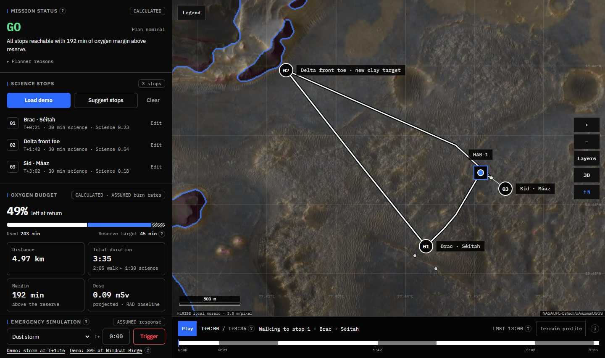

# ARES: Astronaut Route & EVA Safety

**Science first. Safety always.**

**Live app: https://ares-mars-alpha.vercel.app**

ARES plans a spacewalk on Mars using real NASA terrain data, and answers one question: can the astronaut get there and back?

- **Challenge:** Interplanetary Survival Guide: Martian Map, [NASA Space Apps Challenge 2026](https://www.spaceappschallenge.org/2026/challenges/interplanetary-survival-guide-martian-map/)
- **Team:** The Ares Initiative



*The Plan view with the demo mission loaded. Map image: NASA/JPL-Caltech/University of Arizona/USGS (HiRISE).*

## The question

Can an astronaut walk to the science and get back safely?

On Mars that question is hard, for three reasons.

- **Radio delay.** A message to Earth and the answer back can take many minutes. Mission Control cannot talk an astronaut home in real time. The answer has to be ready in the habitat and in the suit.
- **Oxygen.** The suit carries a fixed supply. Every step and every minute of science uses some of it, and a reserve must still be there at the airlock.
- **Terrain.** Steep slopes, soft sand and rough ground slow a person on foot or stop them. The shortest line on a map is often not the safest walk.

Existing Mars maps show regions or the whole planet. A spacewalk happens over a few kilometres. ARES works at that scale, for one walk at Jezero Crater's ancient river delta, where clay and carbonate rocks may hold signs of past life.

## Try it in 60 seconds

Open the [live app](https://ares-mars-alpha.vercel.app). It runs in the browser on a laptop or tablet, with nothing to install.

1. **Story tab.** Press **Run the demo**. Four guided steps show the plan, the reliability check, a dust storm and the walk home.
2. **Plan tab.** Press **Load demo**. Then pick an emergency (for example **Dust storm**) and press **Trigger**. Try **3D** on the map, and open **More details** for **Mission reliability**.
3. **Science tab.** A short, plain explanation of the data, the method, the checks and the limits.

## What ARES does

- **Plans the route on real terrain.** The astronaut picks science stops. ARES finds the fastest safe walk from the habitat to each stop and home, around steep slopes, soft sand and rough ground.
- **Keeps an oxygen budget and a reserve.** It adds up walking and science time, turns that into oxygen used, and shows the margin left above a 45 min reserve.
- **Draws the safe-return zone.** A blue edge marks everywhere the astronaut can still reach and get home from with the reserve intact. It shrinks as stops are added.
- **Gives one status with its reason.** GO, CAUTION or NO-GO, always as a word with the reason written out, never colour alone.
- **Re-plans in five emergencies.** Dust storm, solar particle event (with a check for nearby shelter), oxygen loss, slower walking and a blocked path. Each one re-plans from where the astronaut is standing at that moment.
- **Tests the plan many times.** A Monte Carlo run walks the same plan 1000 times with slightly different speeds and oxygen use, and reports how often the astronaut gets home with the reserve.
- **Says how sure it is.** Every number carries an evidence level: observed, calculated, interpreted or assumed.
- **Shows the walk in 3D.** The same route and zone over the real elevation model.
- **Scores science stops.** Each stop shows its science value from orbital mineral data, and ARES can suggest stops by science gained per minute of oxygen.

The demo mission, as the planner computes it today (from [docs/demo-numbers.md](docs/demo-numbers.md), which the tests keep equal to the code):

| | |
|---|---|
| Route | Habitat, three science stops, habitat |
| Distance | 4.97 km |
| Total time | 3:35 |
| Oxygen margin above the reserve | 192 min |
| Oxygen at return | 49% |
| Status | GO |
| Dust storm at T+1:16 | EVA NO-GO (aborted). Return home CAUTION: a 57 min walk, home with 66% oxygen and 244 min of margin |

## Real NASA data

All terrain in the app is real data, processed by the scripts in `pipeline/`. Full references, links and what we checked are in [docs/sources.md](docs/sources.md).

| Dataset | Instrument and mission | What ARES uses it for | DOI or credit |
|---|---|---|---|
| Mars 2020 Terrain Relative Navigation HiRISE DTM Mosaic (Fergason et al. 2020) | HiRISE, Mars Reconnaissance Orbiter | Elevation, slope and ground roughness, which set walking speed and no-go ground | doi:10.5066/P9REJ9JN. NASA/JPL-Caltech/University of Arizona/USGS |
| Mars 2020 Terrain Relative Navigation HiRISE Orthorectified Image Mosaic (Fergason et al. 2020) | HiRISE, Mars Reconnaissance Orbiter | The map picture under the route | doi:10.5066/P9QJDP48. NASA/JPL-Caltech/University of Arizona/USGS |
| THEMIS-derived Thermal Inertia of Jezero Crater (Edwards & Buz 2021) | THEMIS, Mars Odyssey | Soft sand: low thermal inertia means loose ground and slower walking | doi:10.5281/zenodo.4931348 (CC BY 4.0). NASA/JPL-Caltech/ASU |
| CRISM targeted observation HRL000040FF, summary parameters from Viviano-Beck et al. 2014 | CRISM, Mars Reconnaissance Orbiter | Science value: a relative clay and carbonate signal for choosing stops | PDS Geosciences Node, doi:10.1002/2014JE004627 (parameter definitions). NASA/JPL-Caltech/JHUAPL |
| Near-surface air temperature (Munguira et al. 2023) | MEDA, Perseverance | Daily low and high temperature along the walk | doi:10.1029/2022JE007559 |
| Surface radiation dose rate (Hassler et al. 2014) | RAD, Curiosity (measured at Gale Crater, applied to Jezero as an estimate) | Radiation dose during the walk | doi:10.1126/science.1244797 |
| Perseverance raw images, waypoints and traverse | Hazcam and Navcam, Perseverance | A ground photo at each rover sampling stop, the habitat position, and the validation below | NASA/JPL-Caltech |
| Mars 2020 Initial Reports (Farley & Stack 2022, 2023) | Perseverance sample dossier, NASA PDS | Positions and descriptions of the rover sampling sites used as stops | doi:10.17189/68tf-re13, doi:10.17189/49zd-2k55 |

Sun position uses the Mars24 algorithm (NASA GISS; Allison & McEwen 2000).

## How it works

1. **Terrain grid.** The data above is put on one grid of about 25 m cells covering the delta front. Each cell has elevation, slope, roughness, thermal inertia and a science value.
2. **Walking model.** Each cell gets a walking speed from a version of Tobler's hiking function: 3 km/h on flat firm ground, slower on slopes, in soft sand and on rough ground. Ground steeper than 25° or too rough is no-go.
3. **Route.** Dijkstra and A* search find the fastest safe path between the habitat and each stop.
4. **Oxygen and reserve.** Walking and science time become oxygen used. What is left above the reserve is the margin, and the margin sets the status.
5. **Safe-return zone.** One search outward from the last stop and one from the habitat give, for every cell, whether the astronaut can go there and still get home with the reserve.
6. **Emergencies.** When something goes wrong, ARES re-plans from the astronaut's position with the new conditions. During a dust storm or solar particle event it shows two statuses: the EVA (aborted, NO-GO) and the walk home (CAUTION or NO-GO).

The planner is deterministic. The same inputs always give the same route and the same numbers, and it has unit tests. No AI or machine-learning model makes or changes a route or a safety decision. A longer explanation is in [docs/how-it-works.md](docs/how-it-works.md).

## Does it match reality?

We ran two checks against data the planner never used.

**Perseverance's real drive.** We laid the rover's actual path, 20.57 km inside our site, over the ARES terrain model.

- ARES rates 99.8% of that path as passable.
- Our slope layer agrees with the rover's own tilt sensor: r = 0.82 over 313 waypoints.
- The path crosses one no-go cell, at Skinner Ridge on the delta front: 41.7 m of path where our slope is 25.8°, just over the 25° limit.

A caveat we keep next to the first number: 98.6% of the whole site is passable, so that figure alone does not prove much. The tilt agreement is the stronger evidence. A rover is also not a person on foot, so this checks the map, not the walking speeds. Details: [docs/validation.md](docs/validation.md).

**Machine learning check.** We trained a machine-learning model (maximum margin planning) on 31 of Perseverance's real drives to learn how NASA's drivers choose routes. Tested on routes it had not seen, it could not beat our physics planner (24.8 m vs 35.3 m for a straight line), so the planner stays deterministic and the ML serves as independent validation.

| Planner | Mean distance from the rover's real route |
|---|---|
| Straight line | 35.3 m |
| ARES physics model | 24.8 m |
| Learned model (with the safety rule) | 24.8 m |

The model trained on 15.38 km of drives. The physics model is 10.4 m closer to the drivers' routes than a straight line, about one grid cell away from them. The learned model chose the same route as physics on 31 of 31 test routes, so it is off by default: no machine-learning model picks a route in ARES. Details: [docs/route-learning.md](docs/route-learning.md).

## How sure we are

Every number in the app carries one of four evidence levels.

| Level | Meaning |
|---|---|
| OBSERVED | Measured by an instrument. We use the published value |
| CALCULATED | Worked out from observed values by a stated formula |
| INTERPRETED | A reading of measured data that depends on a judgement, such as "this spectral signal means clay" |
| ASSUMED | Our own choice for the demo. Not measured |

The human-performance numbers are ASSUMED: walking speed in a suit, oxygen use while walking and working, the size of the reserve, and how much a dust storm slows a person. They are reasonable round figures, not spacesuit test data. The reliability run shows how much they matter. On a harder stretch mission the plan says CAUTION with 18 min of margin, and 279 of 1000 simulated walks end below the reserve. That simulation tests our own assumptions. It is not a measured mission success rate.

Every parameter, its source and its evidence level is listed in [docs/parameters.md](docs/parameters.md). What ARES cannot do is in [docs/LIMITATIONS.md](docs/LIMITATIONS.md). The top three limits:

- **Walking and oxygen are estimates.** They are not based on Mars spacesuit measurements.
- **The rock layer is a roughness measure, not a boulder count.** The elevation data cannot see small boulders.
- **The solar particle event is illustrative, and the radiation baseline was measured at Gale Crater.** Perseverance carries no radiation detector, so the Curiosity value is applied to Jezero as an estimate.

## Builds on

ARES follows ideas from earlier traverse planners. No data or code from them is used.

- **NASA SEXTANT** (MIT and NASA Ames): plans walking routes for astronauts over rough terrain.
- **xGDS traverse planner** (NASA Ames): plans traverses with constraints of place and time, built around reachability.
- **MoonPath**: automated astronaut routes near the lunar south pole that minimise metabolic workload.

References are in [docs/sources.md](docs/sources.md) and [docs/how-it-works.md](docs/how-it-works.md).

## Run it locally

You need Node.js and npm. The team builds with Node 22; `app/package.json` does not pin a version.

```bash
cd app
npm ci
npm run dev
```

Then open the address Vite prints.

| Command (in `app/`) | What it does |
|---|---|
| `npm test` | Runs the unit tests: planner, emergencies, reliability, and checks that the docs match the code |
| `npm run test:speed` | Runs the timing tests, which are kept out of `npm test` |
| `npm run build` | Builds the app for production into `app/dist` |

Optional: `pipeline/` holds the Python scripts that rebuild the terrain grid, the basemap, the validation and the route-learning results from NASA's files. See [pipeline/README.md](pipeline/README.md).

## Repository map

| Path | What is in it |
|---|---|
| `app/src/planner/` | The planner: walking model, route search, oxygen, safe-return zone, emergencies, reliability, and their tests. No interface code |
| `app/src/components/` | The interface: Story, Plan and Science pages, the map, the sidebar, the 3D view, the guided demo |
| `app/public/data/` | The terrain grid (`site.json`) and the basemap, both built from NASA data |
| `pipeline/` | Python scripts that build the data and run the two validation checks |
| `docs/demo-numbers.md` | Every headline number, kept equal to the planner by the tests |
| `docs/how-it-works.md` | The method, in plain words |
| `docs/validation.md` | The check against Perseverance's drive |
| `docs/route-learning.md` | The machine-learning check |
| `docs/parameters.md` | Every parameter with its source and evidence level |
| `docs/assumptions.md` | Every modelling assumption and why we made it |
| `docs/LIMITATIONS.md` | What ARES does not do |
| `docs/sources.md` | Every dataset and paper, with links |
| `docs/ai-disclosure.md` | Where and how AI tools were used |

## AI use

We used AI coding assistants (Claude Code and ChatGPT) to help write and review code and documentation. Early on, we used an AI assistant to brainstorm options. The team chose and developed the ARES concept from a teammate's design document, and decided its scope, data, methods and validation. Team members gave the instructions, reviewed the output and ran the tests. Every route and safety decision in the app comes from deterministic algorithms, not from AI.

Our mission patch is AI-generated. It carries a visible "AI-generated" label wherever it appears as an image, and it uses no NASA branding. The repository also contains code for an optional chat assistant. It is not enabled in the app and is not part of the submission. The full disclosure is in [docs/ai-disclosure.md](docs/ai-disclosure.md).

## Credits and licence

- **Images and terrain:** NASA/JPL-Caltech/University of Arizona/USGS (HiRISE image and elevation mosaics, USGS Astrogeology).
- **Thermal inertia:** NASA/JPL-Caltech/ASU (THEMIS), from Edwards & Buz 2021.
- **Minerals:** NASA/JPL-Caltech/JHUAPL (CRISM), from the PDS Geosciences Node.
- **Rover photos, waypoints and traverse:** NASA/JPL-Caltech (Mars 2020 Perseverance).
- **Temperature and radiation:** the Perseverance MEDA and Curiosity RAD instrument teams, through the papers cited above.

ARES is not affiliated with or endorsed by NASA. The NASA logo is not used.

Code: MIT licence, copyright The Ares Initiative. See [LICENSE](LICENSE).
