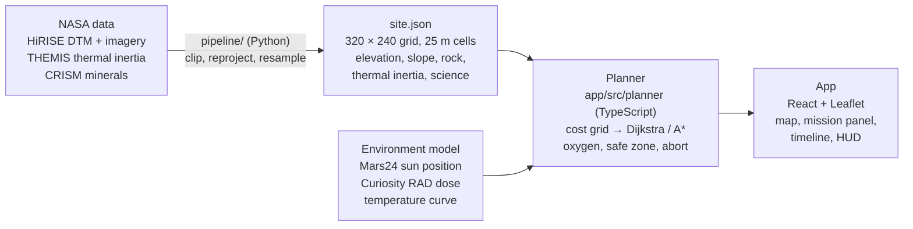

# ARES — Astronaut Route & EVA Safety system

**Science first. Safety always.**

ARES is a route planner for an astronaut walking on Mars. It works like a map app that also tracks oxygen and tells you when you must turn back. The astronaut picks science stops at Jezero Crater's ancient river delta. ARES plans the fastest safe walk around steep slopes, boulder fields and soft sand, and adds up walking time, oxygen and radiation dose. It draws a **safe-return zone** showing everywhere the astronaut can still reach and get home from. It gives a GO / CAUTION / NO-GO status with the reason written out, and it plays the walk across the Martian day. Dust storm and solar particle event buttons show an instant abort route home. ARES was built by The Ares Initiative for the NASA Space Apps Challenge 2026, challenge *Interplanetary Survival Guide: Martian Map*.

> **Live demo:** _link to be added_
> **Demo video:** _link to be added_

## The problem

NASA's challenge asks teams to build "a layered, integrated view of a location or route on the Martian surface that pulls together data from multiple NASA science missions and could help a human explorer plan and carry out a successful Marswalk while conducting new and exciting science along the way" ([challenge page](https://www.spaceappschallenge.org/2026/challenges/interplanetary-survival-guide-martian-map/)).

Tools like JPL's Mars Trek and the USGS-NASA geologic maps show Mars at a regional or global scale. A spacewalk happens at the scale of a few kilometres. An astronaut on foot needs to know which slope is too steep, where the sand is soft, how much oxygen the walk will use, and how far they can go and still get home. ARES answers those questions for a single EVA.

## Key features

- **Layered map**: Mars imagery with toggleable analysis layers (walking difficulty, slope, soft sand, boulders, science value). Each layer is labelled with its data type and the NASA mission it comes from.
- **Route planner**: click to add science stops and set how long to stay. ARES finds the fastest safe route habitat → stops → habitat.
- **Oxygen budget**: a gauge shows oxygen left at return and the margin above the required reserve.
- **Safe-return zone**: a glowing cyan boundary around everywhere still reachable with a safe walk home. It shrinks as stops are added.
- **Status light**: GO / CAUTION / NO-GO, always with the word and the reason, never colour alone.
- **Sol timeline**: play or scrub through the walk; the astronaut marker moves while sun elevation, temperature and radiation update.
- **Emergencies**: Dust Storm and Solar Particle Event buttons turn the status red, collapse the zone, and draw an abort route home from the astronaut's current position.
- **Helmet HUD**: a full-screen minimal view with heading, distance to the next stop, oxygen, margin and dose.
- **Ground view**: a Perseverance rover photo at each stop.

## How it works



1. **Data → grid.** Python scripts in [`pipeline/`](pipeline/) clip NASA datasets to the Jezero delta front (18.40–18.50 N, 77.36–77.50 E). They reproject everything onto one 320 × 240 grid of 25 m cells and save it as `app/public/data/site.json`.
2. **Grid → cost.** For each cell, the planner works out walking speed with a version of **Tobler's hiking function**, slowed for soft sand (low thermal inertia) and boulders. Cells that are too steep (> 25°) or too rocky are no-go.
3. **Cost → route.** The planner treats the grid as a graph and uses **Dijkstra and A\*** to find the fastest safe path between stops. It is deterministic, with no machine learning, so every route is predictable, explainable and testable. We checked it against the real routes Perseverance's drivers chose. Its routes are on average 24.8 m from theirs, and a machine-learning model trained on those routes could not do better on routes it had not seen ([`docs/route-learning.md`](docs/route-learning.md)).
4. **Route → safety.** The planner adds up walking and science time, turns it into oxygen used, and checks the margin against the reserve. A full-field search from the habitat gives the walk-home time from every cell. That powers the safe-return zone and the abort route.
5. **Planner → app.** The React app draws the layers, route and zone on a Leaflet map (equirectangular, `EPSG:4326`, to match Mars Trek tiles). It runs the planner again every time the plan changes.

## Run it locally

You need Node.js 22.12 or newer.

```bash
cd app
npm ci          # install exact dependency versions
npm run dev     # start the app at the URL Vite prints
npm test        # run the planner and app tests
```

## Data sources

ARES combines six NASA data types: HiRISE imagery and elevation (Mars Reconnaissance Orbiter), MOLA (Mars Global Surveyor), THEMIS (Mars Odyssey), CRISM (MRO), MEDA (Perseverance) and RAD (Curiosity). Every dataset and paper, with links and how we use it, is in **[docs/sources.md](docs/sources.md)**.

Images: NASA/JPL-Caltech, plus the instrument team named with each image.

## Model assumptions

Every number in the planner either has a source or is labelled as our assumption. Examples: the 8-hour oxygen supply, walking speed, the 45-minute reserve, and the solar particle event multiplier (illustrative). The full list is in **[docs/assumptions.md](docs/assumptions.md)**.

## Space Apps submission

Rules, deadline and judging criteria are summarised, with links to the official pages, in **[docs/submission.md](docs/submission.md)**.

## AI use

AI coding and chat assistants helped us write and test the code and docs. Every route and safety decision in the app comes from deterministic algorithms, not AI. Full disclosure: **[docs/ai-disclosure.md](docs/ai-disclosure.md)**.

## Team

**The Ares Initiative**: a team of six. Everyone shares every role: data, planner, frontend, design and story.

## License

[MIT](LICENSE)
