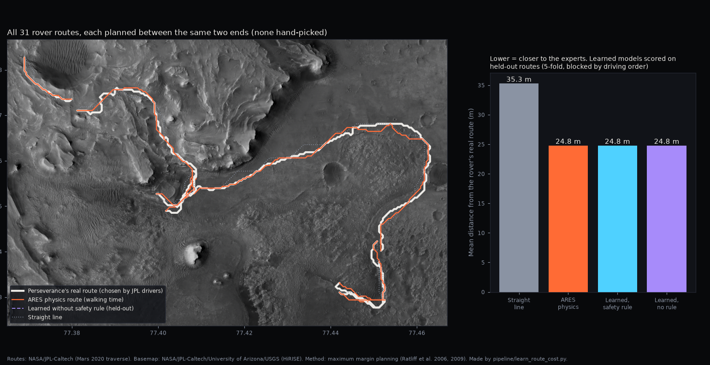

# ARES — can machine learning route better than our planner?

**Question:** Perseverance's human drivers at JPL chose every route the rover drove. If a machine learns from those real routes which ground experts avoid, does a planner using what it learned pick routes **closer to the experts'** than the ARES physics model (walking time only)?

**Short answer:** no. The physics model already plans routes that are on average **24.8 m** from the rover's real routes, about one grid cell. That is **10.4 m closer than a straight line** (95% interval 4.0 to 17.1 m). The learned model never beat it on routes it had not seen. On all 31 test routes it chose exactly the physics route. Without our safety rule, training pushed towards *less* caution, and that made routes *worse* even on the training routes (27.4 m vs 24.85 m).

**What we take from it:** this is independent evidence that the planner's walking model picks lines the way expert drivers do, at the 25 m scale of our grid. It also backs the design rule that **routing stays deterministic: the planner decides.**

Everything here is reproducible: `python pipeline/learn_route_cost.py` (about 35 minutes). Every number below is copied from its output, `pipeline/data/route_learning.json`.

## Data

| | |
|---|---|
| Source | NASA's Mars 2020 "Where is Perseverance" traverse file, one line per drive (NASA/JPL-Caltech): <https://mars.nasa.gov/mmgis-maps/M20/Layers/json/M20_traverse.json>. Downloaded 14 November 2026 |
| Used | The rover's path inside our site, in driving order, cut into routes of about 500 m |
| Kept | **31 routes, 15.38 km, sols 105–770** |
| Dropped | 9 routes that wander (straight-line distance under 0.6 × path length, usually science work at an outcrop, not travel). None dropped for touching no-go ground |
| Independence | The traverse was never used to build the terrain layers. [`validation.md`](validation.md) uses the same file for a different question: is the ground the rover drove on passable? |

Each route is turned into a path of grid cells (the same 320 × 240, 25 m grid the planner uses). Loops and pointless "staircase" corners are removed, because a grid planner would never take them.

## Method

This is **learning a cost function from demonstrations** (inverse optimal control). We use **maximum margin planning** in its exponentiated, LEARCH-style form:

- Ratliff, N.D., Bagnell, J.A., Zinkevich, M.A. (2006). Maximum margin planning. *Proceedings of the 23rd International Conference on Machine Learning (ICML '06)*, 729–736. doi:10.1145/1143844.1143936
- Ratliff, N.D., Silver, D., Bagnell, J.A. (2009). Learning to search: Functional gradient techniques for imitation learning. *Autonomous Robots* 27, 25–53. doi:10.1007/s10514-009-9121-3

How it works, step by step:

1. **Features.** Each passable cell gets 7 features: walking time from our Contract 2 model (relative to flat firm ground), slope above 8°, slope above 15°, roughness, soft sand (thermal inertia under 175), loose ground (thermal inertia 175–250), and "within 50 m of a no-go cell".
2. **Cost.** A cell's cost per meter is `walk_time^a × exp(v1·f1 + … + v6·f6)`. With `a = 1` and every `v = 0` this is exactly the ARES physics model. `e^v` reads as "the experts treat this ground as e^v times dearer".
3. **Plan.** For each rover route, plan between its two ends with Dijkstra, using the same 8-neighbour, no-corner-cutting rules as `app/src/planner/search.ts`.
4. **Learn.** If the planned route is "cheaper" than the expert's, the weights are wrong. Nudge them so the expert's route gets cheaper and the planned route dearer (a subgradient step). The planner is made to work a little harder than the expert while learning: cells more than 37.5 m from the expert's route are slightly cheaper ("loss augmentation"). So the weights must beat the expert by a margin, not just tie. The weights are pulled back towards the physics model, so they only move when the routes clearly say so. 150 steps.
5. **Choose a checkpoint.** Every 10 steps, measure how far the planned routes are from the experts' **on the training routes only**, and keep the best. Checkpoint 0 is the physics model itself.

We trained two versions:

| Version | Rule | Why |
|---|---|---|
| **With safety rule** (the shipped model) | Hazard weights ≥ 0 and walking-time power ≥ 1: the model may make routes **more careful** than physics, never less | The only kind of change we would ever let into an astronaut's planner |
| **No rule** | None | To see what the rover data alone says |

All settings (route length, step size, margin, regularization, folds) were fixed before looking at test scores and are listed in `route_learning.json` under `training`.

## How we tested it

**Blocked 5-fold cross-validation in driving order.** The 31 routes are split into five blocks along the rover's drive. Each block is planned by a model trained only on the other four. Because the blocks follow the drive, the test routes are on ground the model did not learn from (for example crater floor vs delta front).

Two scores per route:

- **Mean distance (m)** between the planned route and the rover's real route, measured both ways and averaged. Lower = closer to the experts.
- **Within 50 m (%)**: the share of the planned route within 50 m of the rover's real route.

## Results (31 held-out routes)

| Planner | Mean distance, mean | Mean distance, median | Within 50 m, mean |
|---|---|---|---|
| Straight line (no terrain) | 35.3 m | 35.3 m | 76.7% |
| **ARES physics model** | **24.8 m** | **25.0 m** | **89.9%** |
| Learned, with safety rule | 24.8 m | 25.0 m | 89.9% |
| Learned, no rule | 24.8 m | 25.0 m | 89.9% |

Head to head, per route (a route counts as "closer" or "further" if the difference is more than 0.5 m):

| Comparison | Average gain | 95% interval (bootstrap) | Closer | Further | Same |
|---|---|---|---|---|---|
| Physics vs straight line | 10.4 m closer | 4.0 to 17.1 m | 18 | 10 | 3 |
| Learned (safety rule) vs physics | 0.0 m | 0.0 to 0.0 m | 0 | 0 | 31 |
| Learned (no rule) vs physics | 0.0 m | 0.0 to 0.0 m | 0 | 0 | 31 |

In every fold, both learned versions chose checkpoint 0, the physics model, because no learned checkpoint got closer to the experts on the training routes.

### Where the data pushes

Without the rule, after 150 steps on all 31 routes, the weights had moved towards **less** caution than physics:

| Feature | Factor learned (×, 1 = physics) |
|---|---|
| Walking time | power 0.83 (physics: 1) |
| Slope above 8° | ×0.95 |
| Slope above 15° | ×1.00 |
| Roughness | ×0.85 |
| Soft sand | ×0.92 |
| Loose ground | ×0.93 |
| Within 50 m of no-go | ×0.99 |

Those weights put routes **27.4 m** from the experts' on the training routes, worse than physics (24.85 m). So the checkpoint rule threw them away. With the safety rule the weights could not move in that direction at all, and stayed at physics.

An earlier run had no staircase cleanup and no checkpoint selection. It drifted the same way and scored worse on held-out routes (29.4 m vs 24.8 m). We fixed the method before the final run, not the test.

## Conclusion

- **The ARES physics model already routes like the experts, at our grid scale.** Its routes stay on average one grid cell from Perseverance's real routes and are clearly closer than straight lines.
- **Machine learning did not improve on it.** With seven terrain features and 31 routes, nothing we could learn got closer to the experts on new ground.
- **The only direction the rover data pushes is "less careful",** and that also made the match worse. We would not let that into an astronaut's planner anyway.
- **So ARES keeps the physics model.** The learned cost is in the planner but **off by default** (`planRoute` only uses it when called with `routeGrid`). The shipped weights are the safety-rule model, which today equals physics. There is no button for it in the app. Whether it ever gets one is for the frontend team.

## What this does and doesn't show

**Does show**

- On real Jezero ground, the walking-time model picks lines close to the ones JPL's drivers picked, and much closer than ignoring the terrain.
- A learned cost of this kind (seven features, 25 m grid) cannot beat it with the drives we have.
- The test is fair: models were scored only on blocks of the drive they never trained on, and every route is in the figure.

**Doesn't show**

- **Rover drivers are not astronauts.** The drivers plan for a six-wheeled rover. Its limits differ from a person's: it has its own tilt limit, can get bogged in sand ripples, must avoid rocks it cannot drive over, and needs paths that suit its cameras, autonavigation and the radio link. A suited astronaut is slowed by slopes and sand differently, can step over rocks a rover must avoid, and tires. "Close to the rover's route" is a proxy for "a good human route", not proof.
- **Drivers have reasons we cannot see.** Many routes go where they do for science targets, imaging, or power and communication schedules, not terrain. We dropped wandering routes, but the routes we kept still carry some of this.
- **The grid limits the test.** At 25 m cells, about one cell of difference is the smallest a route can differ by. The physics model's 24.8 m sits at that floor, so a better model might not be able to show it here.
- **Few, connected routes.** 31 routes from one rover's single path; nearby routes are not independent. The 95% intervals treat routes as independent, so they are somewhat too narrow.
- **It says nothing about oxygen or safety numbers.** Those always come from the Contract 2 model, whichever route is chosen.

## Files

| File | What it is |
|---|---|
| `pipeline/learn_route_cost.py` | Training and testing script (Python: numpy, scipy, matplotlib) |
| `pipeline/data/route_learning.json` | Every score, per-fold weights, per-route results, settings |
| `docs/images/route_learning.png` | The figure above |
| `pipeline/make_ml_charts.py` | Draws the three charts in the Science tab's machine-learning section (per-route distances, closer / same / further counts, learned factors) from `route_learning.json`, into `app/public/images/` |
| `app/public/data/route-model.json` | The shipped model (safety-rule version, today equal to physics), with its source, scores and cross-check values. `python pipeline/learn_route_cost.py --export-model` rewrites it from `route_learning.json` |
| `app/src/planner/learned.ts` | Reads the model (refusing any that is less careful than physics) and builds the learned grid for `planRoute(..., { routeGrid })`. Off by default |
| `app/src/planner/learned.test.ts` | Tests: default planner byte-identical to before; demo mission 4.97 km, GO, 49% at return; Python and TypeScript features agree cell for cell; no-go cells unchanged; safety rule enforced |
