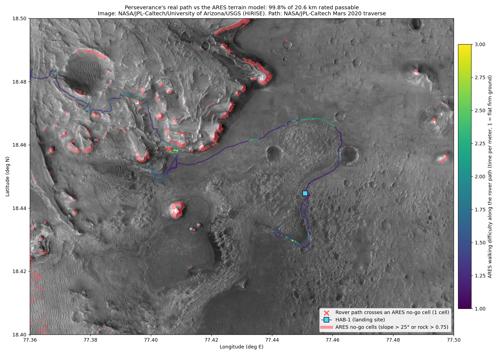

# ARES — independent check against Perseverance's real drive

**Question:** Perseverance really drove across this ground. Does the ARES terrain model agree that the ground it drove on can be crossed?

**Short answer:** yes. ARES rates **99.8%** of the rover's real path inside our site as passable, and the rover's own tilt sensor agrees with our slope layer. But read ["What this does and doesn't show"](#what-this-does-and-doesnt-show) before quoting that number: 98.6% of the *whole site* is passable, so this check mostly shows we have not marked real, drivable ground as blocked.

Everything here is reproducible: `python pipeline/validate_traverse.py`. Every number below is copied from its output (`pipeline/data/traverse_validation.json`).

## What we checked

1. Took every rover waypoint, and points sampled every 10 m (or closer) along the real drive path between them.
2. For each point, looked up the ARES cell under it: slope, rock (roughness) and thermal inertia.
3. Applied the planner's own rule (the same one `buildCostGrid` uses): a cell is **no-go if slope > 25° or rock > 0.75**.
4. Compared the ground under the rover with the site as a whole.
5. Changed the two limits to see how much the answer depends on them.
6. Compared our slope with the tilt the rover measured at each end-of-drive stop.

## Data source

NASA's official Mars 2020 "Where is Perseverance" map layers (NASA/JPL-Caltech):

| File | What it is | Link |
|---|---|---|
| Traverse | The rover's drive path as lines, one per drive | <https://mars.nasa.gov/mmgis-maps/M20/Layers/json/M20_traverse.json> |
| Waypoints | End-of-drive positions with the rover's measured tilt | <https://mars.nasa.gov/mmgis-maps/M20/Layers/json/M20_waypoints.json> |

- Downloaded 14 November 2026; the files then ran to sol 2022 and 46.05 km of driving.
- **20.57 km** of that path lies inside our bounds (sols 14–896), touching 755 of our cells. 313 waypoints are inside our bounds.
- **Independence:** none of this was used to build the terrain layers, which come from orbital data only (HiRISE, THEMIS, CRISM). The one overlap: the first waypoint, the landing point, was used to place the habitat.

## Results

| Measure | Rover path | Whole site |
|---|---|---|
| **Rated passable by ARES** (share of path length / share of cells) | **99.80%** | 98.63% |
| Path length on no-go cells | 41.7 m of 20,570 m | — |
| No-go cells touched | 1 of 755 | — |
| Waypoints on passable cells | 310 of 313 (99.04%) | — |
| Slope, middle value (median) | 3.6° | 4.3° |
| Slope, 90th percentile | 9.6° | 11.6° |
| Slope, 99th percentile | 16.5° | 25.6° |
| Slope, maximum | 25.8° | 61.1° |
| Rock (roughness), median | 0.10 | 0.13 |
| Rock, 90th percentile | 0.19 | 0.29 |
| Rock, 99th percentile | 0.40 | 0.63 |
| Rock, maximum | 0.58 | 1.00 |
| Soft sand (thermal inertia under 175) | 4.8% | 9.2% |
| Walking difficulty (time per meter, flat firm ground = 1) | 1.48 | 1.65 |

In plain words: the rover stayed on ground that ARES rates as **gentler, smoother and firmer than the site average**. It drove on about half as much soft sand as the site average and never touched a cell rougher than 0.58.

### The one place the rover crossed a no-go cell

| Where | Path length | Our slope | Our rock | Rover sols |
|---|---|---|---|---|
| 18.4588 N, 77.4060 E — Skinner Ridge, at the delta front | 41.7 m | 25.8° | 0.53 | 464, 474, 477, 501 |

This is a real sampling site: Perseverance worked on this outcrop at the foot of the delta scarp. Our slope value for a cell is the 90th percentile of the 5 m slopes inside it, so one steep ledge in a 25 m cell can push the whole cell just over the 25° limit (here by 0.8°). The rover worked on the gentler part of the same cell. This is the conservative side to be wrong on: ARES would send an astronaut around.

### The rover's own tilt sensor

At each end-of-drive stop the rover reports its tilt. That is a direct measurement on the ground, taken by a different instrument from anything we used.

| Measure | Value |
|---|---|
| Rover tilt at the 313 waypoints: median / 90th percentile / max | 3.3° / 11.1° / 20.3° |
| Our slope at the same waypoints: median / 90th percentile / max | 5.0° / 12.4° / 25.8° |
| Waypoints where our slope is at least the rover's tilt | 78.6% |
| Correlation between rover tilt and our slope | 0.82 |

Our slope runs a little higher than the rover's tilt, as it should: it describes the steepest part of a 25 m cell, while the tilt is measured over the rover's own length.

The waypoint file also carries an elevation for each stop. It matches our elevation layer closely (median difference 0.25 m, 99th percentile 2.7 m). We believe NASA takes that elevation from the same HiRISE terrain model we used, so this confirms our coordinates and gridding are right, not that the terrain model itself is right.

## Sensitivity

How the answer changes if our two limits are moved. Each cell shows the share of the rover's path length rated passable, with the share of the whole site in brackets.

| | Rock limit 0.65 | Rock limit 0.75 (ours) | Rock limit 0.85 |
|---|---|---|---|
| **Slope limit 20°** | 99.47% (site 97.18%) | 99.47% (site 97.38%) | 99.47% (site 97.49%) |
| **Slope limit 25° (ours)** | 99.80% (site 98.36%) | **99.80% (site 98.63%)** | 99.80% (site 98.78%) |
| **Slope limit 30°** | 100.00% (site 98.89%) | 100.00% (site 99.19%) | 100.00% (site 99.38%) |

- The **rock limit makes no difference** to the rover path anywhere in this range, because the rover never crossed a cell rougher than 0.58. So this check cannot tell us whether 0.75 is the right rock limit.
- The **slope limit** moves the result by about half a percentage point across 20° to 30°. The conclusion does not depend on the exact value we chose.

## The picture

The rover's path is coloured by ARES walking difficulty (dark = easy, yellow = slow). Red patches are ARES no-go cells. The red cross marks Skinner Ridge. Notice the rover going **around** the rough Séítah ground south-west of the landing site and climbing the delta through the gaps between the red scarps, which is the same kind of route ARES would plan.

Image: NASA/JPL-Caltech/University of Arizona/USGS (HiRISE). Path: NASA/JPL-Caltech.

## What this does and doesn't show

**What it shows**

- ARES does not block ground that is known to be crossable. 20.5 km of real driving, and we mark 42 m of it as no-go.
- Our slope layer agrees with an independent measurement on the ground (the rover's tilt), and our map coordinates line up with NASA's.
- The result holds across a reasonable range of slope and rock limits.

**What it doesn't show**

- **It does not prove an astronaut could walk the rover's path.** A rover and a person in a suit have different limits: wheels and legs fail on different ground, a rover does not get tired or run out of oxygen, and it can take days over a stretch a person must cross in minutes.
- **The path is biased toward safe ground.** Rover drivers choose gentle, smooth routes on purpose, using this same orbital imagery. A path picked to avoid hazards will pass a hazard check; that is partly why 99.8% is so high.
- **The bar is low.** 98.6% of the whole site is passable by our rule, so even a random path would score in the high 90s. The more telling result is the comparison of slope, roughness and sand above, and the tilt agreement.
- **It only tests one direction.** It checks that we do not block good ground. It cannot check that everything we call passable really is: the rover never tried to cross the places we would most like to test.
- **It says nothing about our rock limit** (see Sensitivity), our soft-sand threshold, walking speeds, or oxygen use. Those remain assumptions; see [`assumptions.md`](assumptions.md).
- **It covers only where the rover went:** the crater floor near the landing site, the delta front and one route up the delta. The south and east of the site are untested.

## Keeping it honest over time

`app/src/planner/rover-traverse.test.ts` loads the 313 waypoints (a small committed copy in `app/src/planner/__fixtures__/rover-waypoints-sample.json`) and fails if fewer than 97.04% of them land on passable cells (the 99.04% we measured, minus 2 points). If someone changes the terrain data or the no-go rule in a way that breaks this agreement, the tests say so.
